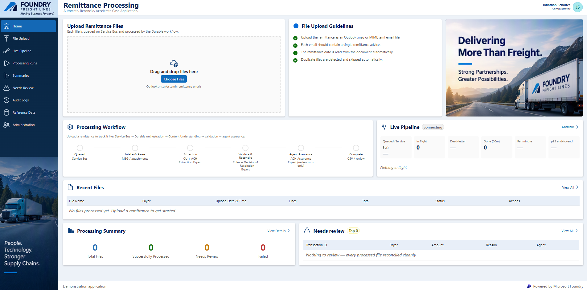
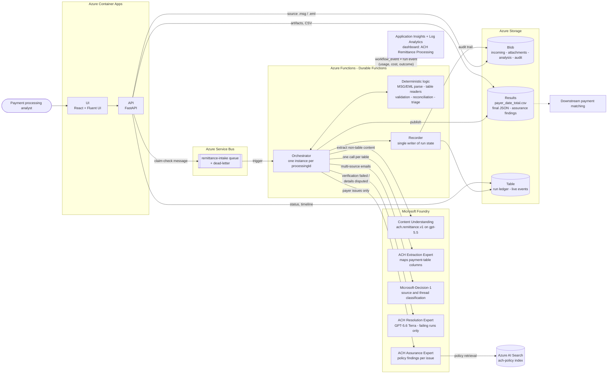
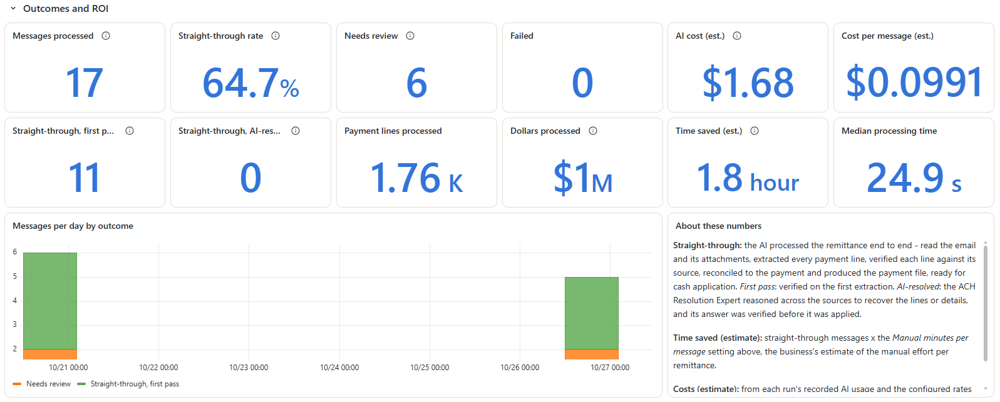

# ACH Remittance Intelligence with Microsoft Foundry and Azure Durable Functions

### End-to-End Example: From Remittance Email to Payment-Match-Ready Data, with Proof

Customers who pay by ACH send the remittance detail separately, by email. It might be a table in the email body, a spreadsheet, a PDF, a scanned image or an EDI 820 printout. This solution accepts each email (Outlook `.msg` or MIME `.eml`), keeps the original and every attachment, and extracts the payer, the payment date and every payment line. It then validates and reconciles the lines to the cent and publishes either a payment-match-ready CSV or a review-required result.

Structured tables are read deterministically and must prove themselves against their own totals. Everything else goes through **Content Understanding in Microsoft Foundry**, and every line it returns is checked against the source text. Runs that need review are split into specific issues, and payer questions go to a Foundry agent that searches the deduction policy and returns a recommendation with citations. Every run records the AI services it used and their estimated cost, and an **Azure Monitor dashboard** shows outcomes, cost per message and operations.

> **Flow:** Email → API → Service Bus → Durable orchestration → deterministic readers + Content Understanding → validation and reconciliation → *(only when needed)* Foundry experts → CSV or review → run event → dashboard

> [!TIP]
> **Deploy it:** follow the step-by-step [Deployment Guide](docs/deployment_steps.md).



*The home page: upload remittance emails, follow each one through the processing workflow, and watch the live pipeline, recent files and the needs-review queue.*

---

## Contents

- [Start Here](#start-here)
- [Patterns This Project Demonstrates](#patterns-this-project-demonstrates)
- [Architecture](#architecture)
- [Project Structure](#project-structure)
- [Deployment](#deployment)
- [Configuration](#configuration)
- [Observability](#observability)
- [Clean Up](#clean-up)
- [License](#license)
- [Disclaimer](#disclaimer)

---

## Start Here

This repository is for teams who want to:

- **Automate cash application from unstructured remittances** without trusting generative output blindly.
- **Use Foundry agents as gated experts:** each agent is called only for the case it owns, and code verifies its answer before anything is applied.
- **Run document AI as an auditable workflow:** one Durable orchestration per message, a single writer of run state, an audit trail for every transition, and safe reprocessing.
- **Show the ROI:** usage and cost per message, how many messages the system handles end to end vs how many are flagged for review, and processing time.

The scenario (a freight carrier receiving ACH remittances, branded as the fictional *Foundry Freight Corp*) is an example. The patterns apply to any "documents in, verified records out" process.

---

## Patterns This Project Demonstrates

**Pattern 1: Deterministic first, generative second, verified always.**
For a payment table in the email body or a spreadsheet, an agent maps the columns once (header, PRO, amount paid, payment detail or statement), and code reads every row. The table is used only if every row parses and the rows sum exactly to the table's own Total row. All other content goes to Content Understanding, and each line it returns must be found in the source text (*grounding*). A reference paired with the wrong amount is flagged, not accepted.

**Pattern 2: Agents as gated experts with code-backed verification.**

| Expert | Called when | Its answer is applied only if |
|---|---|---|
| **ACH Extraction Expert** | A source has a payment table | The mapped rows reconcile to the table's total |
| **Microsoft-Decision-1** | An email has several candidate sources | (Classification only: payment detail, transfer proof, statement, correspondence) |
| **ACH Resolution Expert** (GPT-5.6 Terra) | Verification failed, or the payer, date or payment reference is missing or disputed | Every recovered line is grounded and the total reconciles. A date or reference must appear in the text it cites. A payer is only ever *recommended*. |
| **ACH Assurance Expert** | A run is flagged with payer questions (short pays, credits, duplicate or conflicting references, several payments, inquiry threads) | Its findings are advisory. An analyst dispositions every review. |

**Pattern 3: A durable, auditable pipeline.**
The upload is stored first and only a reference travels on the queue (*claim check*). The processing ID is the content hash, so duplicates are detected. One Durable Functions orchestration runs per message, and a single Recorder writes the run ledger, the live timeline and the audit blob. Failures land in a dead-letter queue and can be replayed.

**Pattern 4: Measure every run.**
Each run records the Content Understanding pages and tokens, the tokens for every agent call and the Decision-1 usage. It prices them with a versioned rate card, classifies the message (how its lines were read) and the outcome, and emits one run event that the dashboard reads. The payment CSV never carries any of this.

**Adapt this to your domain:** lockbox and remittance processing, accounts payable invoices, freight bills and proofs of delivery, claims intake, or any process where extracted values must be *proven* before they are posted.

---

## Architecture



For a step-by-step walk through one remittance, from upload to CSV or review, see [How It Works](docs/how-it-works.md).

### Core Components

| Component | Technology | Role |
|---|---|---|
| UI | React, Fluent UI, nginx on Azure Container Apps | Upload, live pipeline, run details (timeline, lines, findings, cost), summaries by payer |
| API | FastAPI on Azure Container Apps | Intake, run status and artifacts; the UI's only backend |
| Intake queue | Azure Service Bus | Claim-check messages, dead-letter and replay |
| Orchestration | Azure Durable Functions (Python) | One orchestration per message; parse, extract, validate, resolve, assure, publish |
| Document extraction | Content Understanding in Microsoft Foundry (`ach.remittance.v1`, GPT-5.5) | Lines and metadata from PDFs, images and other documents |
| Experts | Foundry agents and Microsoft-Decision-1 | Column mapping, classification, resolution, assurance |
| Policy retrieval | Azure AI Search (`ach-policy`, text-embedding-3-large) | The deduction and cash-application policy the Assurance Expert cites |
| State and artifacts | Azure Storage (Blob, Table) | Originals, attachments, analysis, results, ledger, audit |
| Observability | Application Insights, Log Analytics, Azure Monitor dashboards with Grafana | Traces, run events, the ACH Remittance Processing dashboard |
| Identity | User-assigned managed identity | Keyless access between every component |

---

## Project Structure

<details>
<summary>Expand the directory tree</summary>

```
├── deploy.ps1                       # Orchestrates the deployment phases
├── agents/                          # Foundry agent definitions, deployer, neutral policy corpus
├── apps/
│   ├── remittance-processor/        # Azure Functions: orchestration, parsing, extraction,
│   │                                #   validation, resolution, assurance, usage and pricing
│   ├── api/                         # FastAPI service
│   └── ui/                          # React + Fluent UI
├── infra/                           # Bicep: main.bicep, apps.bicep, reusable modules in core/
├── observability/                   # Dashboard generator and the generated dashboard definition
├── schemas/                         # Versioned contracts: analyzer, results, manifest, intake, assurance
├── scripts/                         # Deploy-*.ps1 phases, smoke test, golden-set evaluation
├── test/load/                       # Load test: replays messages from a folder against a deployment
├── docs/                            # How it works, deployment guides, developer guide, evaluation, load testing
├── media/                           # Screenshots and diagrams used by the docs
└── samples/                         # synthetic/: 20 generated test scenarios; real messages stay local (git-ignored)
```

</details>

---

## Deployment

You need an Azure subscription with quota for GPT-5.5, GPT-5.6 Terra, Microsoft-Decision-1 and text-embedding-3-large where Content Understanding is available (tested in `westus3`), and Owner rights (or Contributor + User Access Administrator).

```powershell
az login
Copy-Item .env.example .env          # your organization's names and PRO rules
./deploy.ps1 -Subscription <subscription-id> -Location westus3 -Environment dev
```

Add `-Private -PrivateUi` to deploy into an existing landing-zone VNet with a VPN-only UI. The script ends with the UI's URL.

| Guide | For |
|---|---|
| [Deployment Guide](docs/deployment_steps.md) | Prerequisites, settings, the six phases and their parameters, private deployment, verification, troubleshooting, teardown |
| [Manual Deployment](docs/manual-deployment.md) | Every resource, setting and role assignment, to deploy without the script or adapt it to your landing zone |
| [infra/README.md](infra/README.md) | Networking, identities and roles, firewall egress |
| [Developer Guide](docs/developer-guide.md) | For changing the code: tests, and running the Function app, API or UI against a deployed environment |
| [Golden-Set Evaluation](docs/evaluation.md) | Measuring accuracy on real messages checked by a person |
| [Load Testing](docs/load-testing.md) | Replaying messages from a folder at a chosen rate to measure throughput, throttling and queue behavior |

> **Cost:** the models, Content Understanding, AI Search and the other services are billable. Each run records its own usage and estimated cost.

---

## Configuration

| What | Where |
|---|---|
| Your organization's names and PRO rules | `.env` (git-ignored) → Function app settings. See [Deployment Guide, Step 3](docs/deployment_steps.md#step-3--configure-for-the-customer) |
| Rates for the per-run cost estimate | [apps/remittance-processor/config/pricing.json](apps/remittance-processor/config/pricing.json): ships with Azure list prices; replace them with your agreement's rates |
| Deployment options (region, sizes, networking) | `deploy.ps1` parameters. See the [Deployment Guide](docs/deployment_steps.md#optional-parameters) |

---

## Observability

The infrastructure phase deploys the **ACH Remittance Processing** dashboard (Azure Monitor dashboards with Grafana): outcomes and ROI (handled end to end vs flagged for review vs failed, estimated time saved), cost and usage per message by payer and date, and operations. Every run also emits a `remittance_run_completed` event to Application Insights. See [observability/README.md](observability/README.md) for the panels and ready-to-run queries.


---

## Clean Up

```powershell
az group delete --name rg-ach-remit-<environment> --yes
```

Then purge the soft-deleted Foundry account; see [Teardown](docs/deployment_steps.md#teardown).

---

## License

This project is licensed under the [MIT License](LICENSE.md).

---

## Disclaimer

**THIS CODE IS PROVIDED FOR EDUCATIONAL AND DEMONSTRATION PURPOSES ONLY.**

This sample is not intended for production use and is provided "AS IS", without warranty of any kind.

- It is a demonstration project. Review, test and harden it (security, networking, resilience, data retention) before any production use.
- Extraction results, agent findings and recommendations are advisory. A person must review every flagged payment before cash is applied.
- You are responsible for complying with your organization's policies and with applicable regulations for financial and personal data.
- Azure services used by this solution incur costs. Cost estimates in the solution are based on list prices and are not a quote.
- All names, companies and payment data in this repository are fictional.
